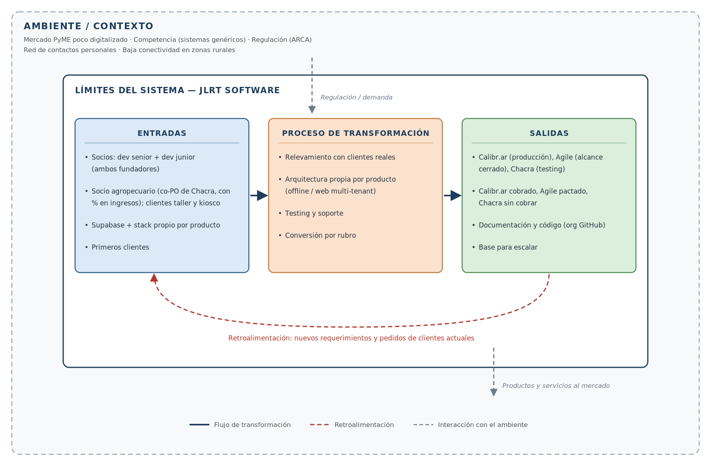
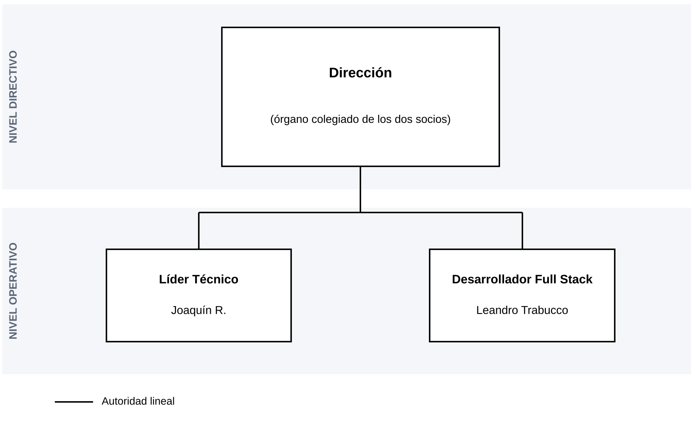
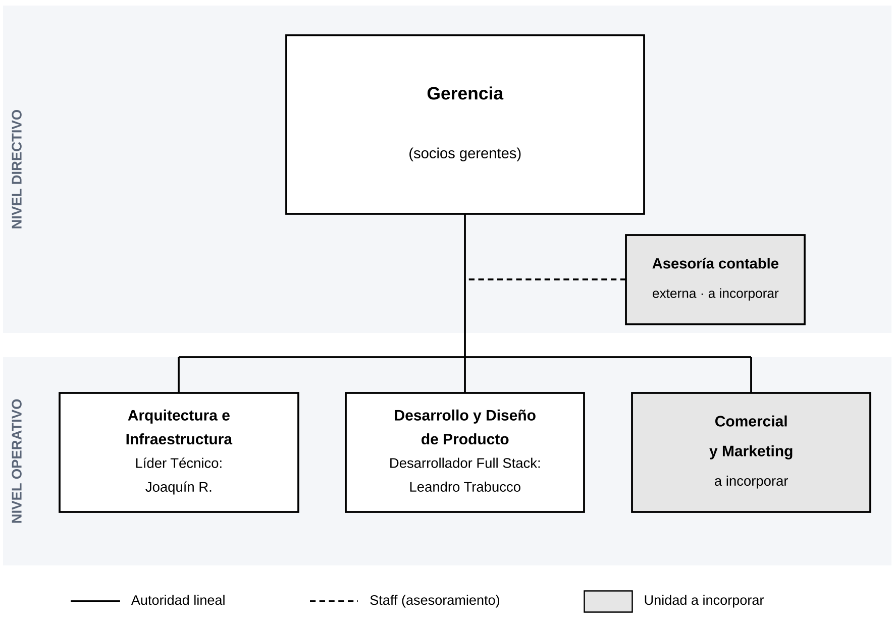

# Estructura de JLRT Software

JLRT Software es un proyecto de software de dos socios que desarrolla sistemas de gestión para PyMEs de rubros específicos: **Chacra** (agro), **Calibr.ar** (talleres mecánicos) y **Agile** (kioscos). Hoy es una sociedad no constituida regularmente (Sección IV de la Ley General de Sociedades). Su visión es pasar a SRL en dos o tres años.

## La organización como sistema abierto

El análisis completo está en la Entrega 1 del trabajo integrador. Su conclusión principal fue que el subsistema comercial prácticamente no existía: las consultas llegaban de palabra y no quedaba ningún registro. El módulo de captación y gestión comercial que documenta este repositorio responde a ese hueco.

## Organigrama actual

Son dos niveles:

- **Directivo:** la **Dirección**, un órgano colegiado de los dos socios.
- **Operativo:** los dos puestos, Líder Técnico y Desarrollador Full Stack.

Las mismas dos personas ocupan los dos niveles: cada socio integra la Dirección y además ocupa un puesto operativo. Por eso la Dirección no lleva nombres: representa la función de dirigir, y los nombres aparecen solo en el puesto que cada uno ejecuta.

| Persona | Nivel directivo | Nivel operativo |
|---|---|---|
| Joaquín R. | Integra la Dirección | Líder Técnico: arquitectura, modelado de datos e infraestructura |
| Leandro Trabucco | Integra la Dirección | Desarrollador Full Stack: funcionalidades, interfaz e identidad visual |

La función comercial no tiene un puesto propio. Cuando llega una consulta, la toma el socio que tiene más tiempo.

## Organigrama propuesto para la etapa SRL

- **Nivel directivo:** la **Gerencia**, integrada por los socios gerentes. Es el órgano de administración de la SRL (Ley 19.550, art. 157).
- **Staff:** una **asesoría contable externa**, a incorporar, unida con línea de trazos porque asesora a la Gerencia pero no tiene autoridad sobre las áreas.
- **Nivel operativo:** tres áreas al mismo nivel. Dos ya existen (Arquitectura e Infraestructura, y Desarrollo y Diseño de Producto). La tercera, **Comercial y Marketing**, es nueva. Cuando se incorpore, se hace cargo de la atención de las consultas que hoy registra el módulo.

Los dos organigramas siguen el modelo piramidal vertical normalizado. Los rectángulos tienen el lado mayor igual al doble del menor: 30 mm de lado menor para el órgano directivo, 20 mm para las áreas y 15 mm para el staff. Las líneas son continuas para la autoridad lineal y de trazos para el staff.
