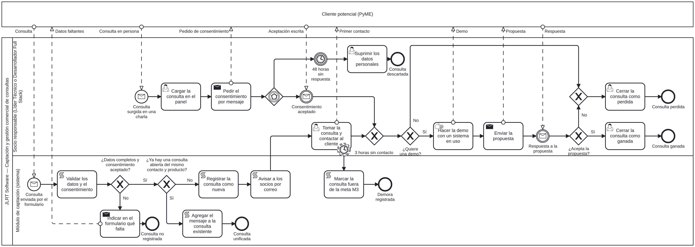

# Proceso de captación y gestión comercial de consultas (BPMN 2.0)

- **Modelo editable:** [`proceso-captacion.bpmn`](proceso-captacion.bpmn). Es BPMN 2.0 estándar y se abre en [bpmn.io](https://demo.bpmn.io) o en Camunda Modeler.
- **Imagen vectorial:** [`proceso-captacion.svg`](proceso-captacion.svg).

## Qué proceso es

Empieza cuando alguien se interesa por un producto de JLRT y termina cuando esa consulta se cierra (ganada, perdida o descartada). Es un **proceso del negocio de tipo operativo o clave**, porque impacta directamente en el cliente y en la venta.

## Participantes

- **Pool “Cliente potencial (PyME)”:** actor externo dibujado como caja negra. Solo se modelan los mensajes que intercambia con JLRT.
- **Pool “JLRT Software — Captación y gestión comercial de consultas”:** contiene el proceso, dividido en dos lanes.
  - **Socio responsable (Líder Técnico o Desarrollador Full Stack):** la función comercial se comparte, así que el lane representa a quien tomó la consulta.
  - **Módulo de captación (sistema):** el comportamiento automatizado (validar, registrar, avisar y medir).

Los flujos de secuencia quedan dentro del pool de JLRT. La comunicación con el cliente usa solo flujos de mensaje.

## Flujo estándar

1. El cliente envía una consulta por el formulario de la landing (evento de inicio de mensaje).
2. El sistema valida los datos y el consentimiento, registra la consulta como nueva y avisa a los socios por correo.
3. Un socio toma la consulta y contacta al cliente.
4. Si el cliente quiere una demo, el socio la hace con un sistema en uso, envía la propuesta y espera la respuesta (evento intermedio de mensaje).
5. Si el cliente acepta, la consulta se cierra como ganada.

## Excepciones

| Elemento | Qué resuelve |
|---|---|
| Compuerta “¿Datos completos y consentimiento aceptado?” | Si falta un dato o la casilla de consentimiento, la consulta no se registra y el formulario indica qué falta. |
| Compuerta “¿Ya hay una consulta abierta del mismo contacto y producto?” | Evita duplicados: el mensaje se agrega a la consulta existente (regla RI12). |
| Temporizador de borde de 3 horas (no interrumpe) | Si la consulta no se toma y contacta en 3 horas, el sistema la marca fuera de la meta M3, pero el proceso sigue. |
| Segundo inicio: “Consulta surgida en una charla” | El socio la carga en el panel y pide el consentimiento por mensaje. Una compuerta basada en eventos espera la aceptación o el vencimiento del plazo. Si el plazo vence, los datos se suprimen (regla RI14). |
| Compuertas “¿Quiere una demo?” y “¿Acepta la propuesta?” | Si la respuesta es no, la consulta se cierra como perdida. |

El camino de la charla se une al principal en una compuerta convergente, después del primer contacto, porque ese contacto ya ocurrió en persona.

## Tipos de tareas

| Tipo | Tareas |
|---|---|
| Script (las resuelve el sistema) | Validar, registrar, avisar, agregar a la consulta existente, marcar fuera de M3 |
| Usuario (un socio, con el panel) | Tomar y contactar, cargar la consulta, suprimir datos, cerrar como ganada o perdida |
| Envío | Indicar qué falta, pedir el consentimiento, enviar la propuesta |
| Manual | Hacer la demo (reunión con el cliente, sin el módulo) |

## El estado de la consulta

El campo `estado` funciona como una máquina de estados finitos: nuevo → contactado → demo → propuesta → cerrado. El diagrama muestra qué actividad dispara cada transición, y el Historial de estados del [diccionario de datos](../datos/diccionario-de-datos.md) registra cada una.
